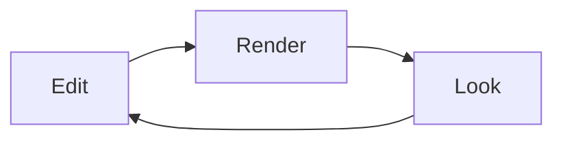
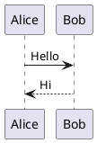

# Images and diagrams

Start with `RMI_MODE=replace` to hide the sources: the picture takes their place, and the source comes
back while the cursor is on it. Otherwise each picture is drawn under its source.

A picture on its own line, drawn under it:

Text before  and after: the image goes under the line.

Two on one line:  

- A list item
  - Nested, and the picture follows its text: 

> A quote with a picture 

| Column | Picture |
| ------ | ------- |
| a      |  |
| b      | text    |

A file that does not exist draws nothing: 

## Formats

The format is told by the bytes of the file, not by its name. PNG goes to the terminal as it is; the rest is
converted to PNG by `magick` (ImageMagick 7) and cached:

- PNG 
- JPEG 
- WebP 
- BMP 
- TIFF 
- SVG, drawn on white 

Not drawn, on purpose: an SVG that points outside itself (the reason is in the log), and a GIF (by its address,
so it is never fetched):

## Remote images

Downloaded with curl the first time (10 s and 20 MB at most), then served from the cache: close Neovim and
open this again, and it is there at once. Badges, GIFs and videos are not fetched.

Among text  it goes below, as a local one does.

## Obsidian

A note inside a vault finds `![[name.png]]` embeds by name, wherever they are in the vault. See
`tests/fixtures/vault/notes/note.md` (`nvim -u scripts/demo_below.lua tests/fixtures/vault/notes/note.md`).

## Diagrams

A Mermaid fence is drawn under its source (needs `mmdr`, `mmdc` or `npx`):

A PlantUML fence too (needs `plantuml`, or `java` with `$PLANTUML_JAR`):

Without the tools nothing is drawn and the reason goes to
`:lua print(require("render-markdown-images.log").path())`.

The end.
