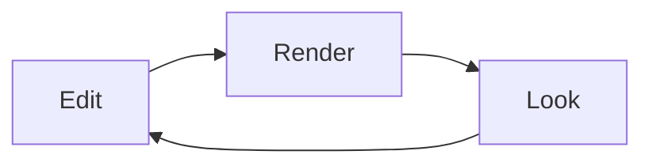
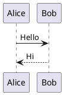

# Images and diagrams

Start with `RMI_MODE=replace` to hide the sources: the picture takes their place, and the source comes
back while the cursor is on it. Otherwise each picture is drawn under its source.

A picture on its own line, drawn under it:

Text before  and after: the image goes under the line.

Two on one line:  

- A list item
  - Nested, and the picture follows its text: 

> A quote with a picture 

| Column | Picture |
| ------ | ------- |
| a      |  |
| b      | text    |

A file that does not exist draws nothing: 

## Diagrams

A Mermaid fence is drawn under its source (needs `mmdr`, `mmdc` or `npx`):

A PlantUML fence too (needs `plantuml`, or `java` with `$PLANTUML_JAR`):

Without the tools nothing is drawn and the reason goes to
`:lua print(require("render-markdown-images.log").path())`.

The end.
